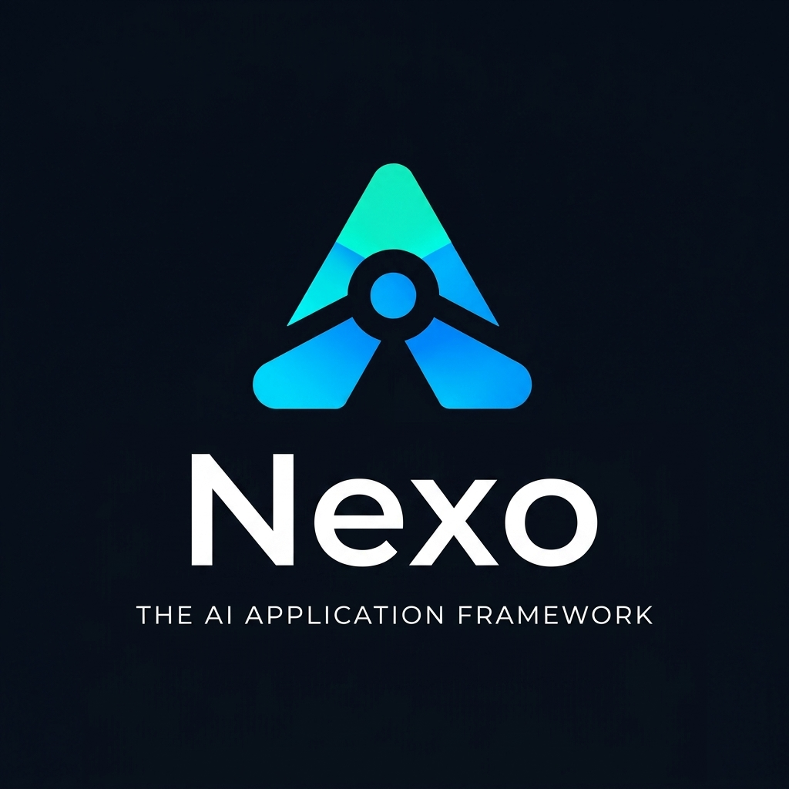

<p align="center">
  <picture>
    <source srcset="./logo.svg" type="image/svg+xml">
    
  </picture>
</p>

<h1 align="center">Nexo</h1>

<p align="center">
  <strong>The AI Application Framework</strong><br>
  <em>A lightweight, modular application framework and runtime for the AI era.</em>
</p>

<p align="center">
  <a href="https://www.npmjs.com/org/nexo-alpha"></a>
  <a href="https://github.com/giribabu22/nexo-alpha"></a>
  <a href="https://github.com/giribabu22/nexo-alpha"></a>
</p>

---

Nexo bridges the gap between software development and AI intelligence. It provides a pure, dependency-free application model for your code and surrounds it with structured context, deterministic decision boundaries, bounded behaviors, autonomous workflows, and deep introspection tooling.

It is also a full-stack framework: declare a data model once, and Nexo gives you the database collection, validation, REST API, TypeScript types, forms, tables, sign-in and file uploads, with production-grade behavior underneath.

```
       ┌────────────────────────────────────────────────────────┐
       │                       AI WORLD                         │
       │     LLM / Intent Parser proposes an action / workflow   │
       └───────────────────────────┬────────────────────────────┘
                                   │  DecisionIntent
       ┌───────────────────────────▼────────────────────────────┐
       │                   CONTROLLED WORLD                     │
       │  Decision Engine evaluates deterministic safety rules  │
       │  APPROVE │ REJECT │ ASK_USER │ ESCALATE │ DEFER        │
       └───────────────────────────┬────────────────────────────┘
                                   │  (Only if APPROVED)
       ┌───────────────────────────▼────────────────────────────┐
       │               NEXO APPLICATION RUNTIME                 │
       │  Modules ──► Services ──► APIs (Hapi) ──► Jobs (Cron)  │
       │  Knowledge Context ──► Audit Trails ──► Verifications  │
       └────────────────────────────────────────────────────────┘
```

---

## Quick Start: Scaffold in Seconds

The fastest way to start a new Nexo project is using `create-nexo-app`:

```bash
# Fullstack React (Vite) + Nexo backend (Default)
npx @nexo-alpha/create-nexo-app my-app

# Standalone modular backend API service
npx @nexo-alpha/create-nexo-app my-service --template backend-api

# Minimal single-file setup
npx @nexo-alpha/create-nexo-app quick-start --template minimal
```

Then cd into your project, install dependencies, and run:

```bash
cd my-app
npm install
npm run dev
```

---

## Monorepo Packages

Nexo is built as a set of modular, composable packages published under the `@nexo-alpha` scope on npm (`https://www.npmjs.com/org/nexo-alpha`):

| Package | npm | Description |
|---|---|---|
| [`@nexo-alpha/core`](./packages/core/README.md) | `0.7.0` | Core runtime: applications, modules, services, declarative APIs, jobs, lifecycle, and event bus. Also the data layer ([docs](./packages/core/README.md#data-layer-models-resources-and-stores-07)): `model`, `resource`, `api.*`, `createAuth`, `createFiles`, and document stores (memory, JSON file, SQLite). |
| [`@nexo-alpha/data`](./packages/data/README.md) | `0.7.0` | The data layer on its own: models, resources (CRUD + REST), document stores, list queries and file uploads. Re-exports `@nexo-alpha/core`, so the code is identical. |
| [`@nexo-alpha/context`](./packages/context/README.md) | `0.7.0` | Application context manifest, knowledge journal (decisions, constraints, state, intents), and structure hashing. |
| [`@nexo-alpha/decision`](./packages/decision/README.md) | `0.7.0` | Deterministic AI decision engine. Rule chains (`permission`, `state`, `constraint`, `confirmation`, `escalation`, `rateLimit`). |
| [`@nexo-alpha/agent`](./packages/agent/README.md) | `0.7.0` | AI agent orchestration layer wiring `UNDERSTAND → KNOW → DECIDE → ACT → VERIFY`, tool registries, and autonomous workflows. |
| [`@nexo-alpha/behavior`](./packages/behavior/README.md) | `0.7.0` | Typed bounded behavior layer: micro-decision primitives (`choice`, `boolean`, `score`), policies, and telemetry. |
| [`@nexo-alpha/web`](./packages/web/README.md) | `0.7.0` | Web search, evidence extraction, and claim verification pipeline for AI research. |
| [`@nexo-alpha/tools`](./packages/tools/README.md) | `0.7.0` | AI & developer introspection: read/write interfaces, verification, live metrics, source scanning, and knowledge graph. |
| [`@nexo-alpha/scheduler`](./packages/scheduler/README.md) | `0.7.0` | Dependency-free cron scheduler for `NexoJob`s, plus a persistent background job queue with retries. |
| [`@nexo-alpha/webhooks`](./packages/webhooks/README.md) | `0.7.0` | Signed, retried webhook delivery with subscription management and receiver-side verification. |
| [`@nexo-alpha/integrations`](./packages/integrations/README.md) | `0.7.0` | Agent toolkits for GitHub and Slack, gated by RBAC like any other tool. |
| [`@nexo-alpha/hapi`](./packages/hapi/README.md) | `0.7.0` | HTTP adapter turning declared `NexoApi`s into running Hapi.js servers with auth, validation, rate limits, request IDs, raw-body uploads, and lifecycle hooks. |
| [`@nexo-alpha/cli`](./packages/cli/README.md) | `0.7.0` | Terminal CLI for architecture inspection, dependency impact tracing, health checks, knowledge graphs, and code generators (`generate resource`, `generate page`, …). |
| [`@nexo-alpha/frontend`](./packages/frontend/README.md) | `0.7.0` | Typed client (`client.resource`, `client.auth`, `client.files`), React hooks (`useResource`, `useAuth`), forms and tables generated from models, the `NexoApp` shell with routing, and UI dashboards. |
| [`@nexo-alpha/create-nexo-app`](./packages/create-nexo-app/README.md) | `0.7.0` | Scaffolding CLI for generating starter templates. |

---

## Build a Full-Stack App

### A feature in three files

One model drives the database collection, validation, the REST API, the TypeScript types, and the forms and tables:

```ts
// users/user.model.ts (shared by server and browser)
import { field, model, type Infer } from "@nexo-alpha/core/model";

export const User = model("users", {
  name: field.string({ minLength: 1 }),
  email: field.email(),
  role: field.enum(["member", "admin"]).default("member"),
  avatar: field.file({ accept: ["image/*"] }).optional()
});
export type User = Infer<typeof User>;
```

```ts
// users/users.api.ts (server): GET/POST /api/users, GET/PATCH/DELETE /api/users/:id
import { resource, type NexoDocumentStore } from "@nexo-alpha/core";
import { User } from "./user.model.js";

export const users = (store: NexoDocumentStore) =>
  resource(User, { store, searchable: ["name", "email"], auth: { write: ["users:write"] } });
```

```tsx
// users/users.page.tsx (browser)
import { NexoForm, NexoResourceTable, NexoStack } from "@nexo-alpha/frontend";
import { User } from "./user.model.js";

export const UsersPage = () => (
  <NexoStack>
    <NexoForm model={User} />
    <NexoResourceTable model={User} search allowDelete />
  </NexoStack>
);
```

Scaffold all three with `npx nexo generate resource user`.

### The server

```ts
import { createApplication, createAuth, createDiskBlobStore, createFiles, createSqliteDocumentStore } from "@nexo-alpha/core";
import { startHapiServer } from "@nexo-alpha/hapi";
import { users } from "./users/users.api.js";

const store = await createSqliteDocumentStore("data/app.db");
const auth = createAuth({ store, secret: process.env.AUTH_SECRET!, defaultScopes: ["users:write"] });

const app = createApplication({ name: "my-app" });
app.module(auth);                                                              // /api/auth/register, login, logout, me
app.module(createFiles({ store, blobs: createDiskBlobStore("data/files") }));  // /api/files
app.module(users(store));                                                      // /api/users

// cors: the browser app below runs on another origin (e.g. a Vite dev server).
await startHapiServer(app, { port: 3000, cors: true, authenticate: auth.authenticate });
```

### The browser app

```tsx
import { createRoot } from "react-dom/client";
import { NexoApp, NexoLoginForm, page } from "@nexo-alpha/frontend";
import { UsersPage } from "./users/users.page.js";

createRoot(document.getElementById("root")!).render(
  <NexoApp
    baseUrl="http://localhost:3000"
    pages={[
      page("/login", () => <NexoLoginForm />, { layout: null }),
      page("/users", UsersPage, { protect: true })   // signed-in users only
    ]}
  />
);
```

### What you get without writing it

- **API:** paging, sorting, search and typed filters (`/api/users?role=admin&sort=-createdAt&limit=20`). It returns 201, 204, 400 (with every validation message), 404 and 409 where they belong.
- **Validation:** one model validates in the browser and on the server, with identical messages, and fields not declared on the model are rejected.
- **Data integrity:**
  - `field.ref()` and `field.file()` must point at existing records and files.
  - Concurrent updates can't overwrite each other.
  - Adding a field with a default needs no migration.
- **SQLite at scale:** filtering, search, sorting and paging run in SQL, and reference fields are indexed. One customer's orders out of 50,000 load in about 3 ms.
- **Sign-in:**
  - scrypt-hashed passwords and one account per email, enforced atomically
  - sessions you can revoke (logout really ends them)
  - limits on failed sign-ins
  - scopes checked per request
  - password reset and email verification through any email provider you plug in
- **File uploads:**
  - raw binary uploads with size and type limits
  - downloads served so uploaded HTML or SVG can't run scripts on your site
  - a file picker in generated forms
- **Frontend:**
  - forms and tables generated from the model, with loading, error and empty states
  - lists that refresh after any change
  - protected pages that follow the session

**Measured** on six features (CRUD, search and paging, relationships, an authenticated POST, sign-in, and file upload), each written with and without these primitives. Both versions pass the same HTTP tests. Application code drops from 731 to 90 lines (−88%), and the places where data shapes are spelled out drop from 17 to 5. See [benchmarks/code-to-intent](./benchmarks/code-to-intent/RESULTS.md).

Reference: [Full-stack primitives](./docs/primitives.md), one concise section per primitive.

## How to Use Nexo: Core Walkthrough

### 1. Build an Application (`@nexo-alpha/core`)

Nexo applications are built around declarative modules, services, and APIs:

```ts
import { createApplication, NexoService } from "@nexo-alpha/core";

export const app = createApplication({
  name: "storefront",
  version: "1.0.0",
  description: "E-commerce platform"
});

class CartService extends NexoService {
  constructor() {
    super({ name: "cart-service" });
  }
  async getCart(userId: string) {
    return { userId, items: [] };
  }
}

const cartService = new CartService();

app.module({
  name: "cart",
  purpose: "Manage user shopping carts",
  status: "in-progress",
  services: [cartService],
  apis: [
    {
      name: "getCart",
      method: "GET",
      path: "/cart/:userId",
      handler: async (ctx) => cartService.getCart(ctx.params.userId)
    }
  ]
});

await app.start();
```

### 2. Serve APIs over HTTP (`@nexo-alpha/hapi`)

Turn your declared module APIs into an HTTP server with validation and authentication:

```ts
import { jwtAuthenticator } from "@nexo-alpha/core";
import { startHapiServer } from "@nexo-alpha/hapi";
import { app } from "./app.js";

const server = await startHapiServer(app, {
  port: 3000,
  // Verifies HS256 bearer tokens; or use createAuth(...).authenticate for built-in accounts.
  authenticate: jwtAuthenticator({ secret: process.env.JWT_SECRET! }),
  rateLimit: { windowMs: 60_000, max: 300 },
  securityHeaders: true
});

console.log(`Server listening at ${server.info.uri}`);
```

APIs that declare `auth: { required: true, scopes: [...] }` answer 401 or 403 before the handler runs; handlers see the caller as `ctx.auth`.

### 3. Schedule Background Cron Jobs (`@nexo-alpha/scheduler`)

Declare recurring cron jobs right inside your modules:

```ts
import { startJobScheduler } from "@nexo-alpha/scheduler";

app.module({
  name: "cleanup",
  jobs: [
    {
      name: "purgeExpiredCarts",
      schedule: "0 * * * *", // every hour
      run: async () => {
        console.log("Cleaning up expired carts...");
      }
    }
  ]
});

const scheduler = startJobScheduler(app);
```

### 4. Deterministic AI Safety Boundary (`@nexo-alpha/decision`)

Prevent AI hallucinations and unauthorized actions using explicit deterministic rule chains:

```ts
import { createDecisionEngine, permissionRule, stateRule } from "@nexo-alpha/decision";

const engine = createDecisionEngine({ name: "order-safety" });

engine
  .addRule(permissionRule({
    name: "owner-only",
    actions: ["cancel_order"],
    check: ({ intent }) => intent.actor === intent.payload?.ownerId,
    message: "You can only cancel your own orders."
  }))
  .addRule(stateRule({
    name: "cancellable-state",
    actions: ["cancel_order"],
    allowedStates: ["pending", "processing"],
    resolveState: async ({ intent }) => fetchOrderStatus(intent.target)
  }));

const outcome = await engine.evaluate({
  action: "cancel_order",
  actor: "user_123",
  target: "order_999",
  payload: { ownerId: "user_123" }
});

if (outcome.result === "APPROVE") {
  // Safe to execute!
} else if (outcome.result === "REJECT") {
  console.error("Blocked:", outcome.reason);
}
```

### 5. Orchestrate AI Agents & Workflows (`@nexo-alpha/agent`)

Wire the full `UNDERSTAND → KNOW → DECIDE → ACT → VERIFY` pipeline:

```ts
import { createAgent, createWorkflow } from "@nexo-alpha/agent";
import { createKnowledge } from "@nexo-alpha/context";
import { engine } from "./decision-engine.js";

const knowledge = createKnowledge();

const agent = createAgent({
  name: "support-agent",
  decisionEngine: engine,
  knowledge
});

// Register tools
agent.tools.register({
  name: "cancel_order",
  description: "Cancels an open order",
  execute: async ({ intent }) => cancelOrderInDatabase(intent.target)
});

// Run with automatic intent parsing, decision verification, and execution
const record = await agent.run("Please cancel order order_999 for user_123");
console.log(record.status); // "SUCCESS", "REJECTED", "ESCALATED", etc.
```

### 6. Inspect & Query Architecture with Nexo CLI (`@nexo-alpha/cli`)

Inspect your architecture and trace impact directly in your terminal:

```bash
# Inspect application modules and APIs
npx nexo inspect

# Check decisions and development status
npx nexo status

# Generate full architecture knowledge graph
npx nexo graph --source-root src --out .nexo/knowledge-graph.json

# Trace the blast radius of changes to a function or module
npx nexo impact "module:cart"

# Check which files have changed since the graph was generated
npx nexo freshness --source-root src

# Scaffold a model + CRUD API + page, or a single page
npx nexo generate resource invoice
npx nexo generate page settings
```

---

## Development & Monorepo Workflows

Clone and build the entire monorepo:

```bash
# Clone the repository
git clone https://github.com/giribabu22/nexo-alpha.git
cd nexo-alpha

# Install dependencies across all packages
pnpm install

# Build all packages
pnpm build

# Run typechecks across all packages
pnpm typecheck

# Run test suites across all packages (unit, integration and type tests)
pnpm test

# Lint (bug-catching rules such as React's rules of hooks; no style rules)
pnpm lint

# Runtime throughput benchmarks (stores, lists on SQLite, workflows, job queue)
pnpm bench

# Re-measure the code-to-intent benchmark
pnpm --filter @nexo/benchmark-code-to-intent measure
```

`build`, `typecheck` and `test` run through [Turborepo](https://turborepo.com), which caches results per package: unchanged packages are skipped on later runs.

Nexo needs Node.js 20 or later; the SQLite document store needs Node.js 22.5 or later.

---

## Documentation

- [Developer Handbook & Guide](./docs/DEVELOPER_GUIDE.md) — Comprehensive guide on architecture, routing, services, and AI, plus the production runtime: workflows over HTTP, auth & RBAC, persistence, job queues, webhooks, observability, frontend dashboards, generators and testing (sections 13–22, including multi-tenant projects).
- [Full-stack primitives](./docs/primitives.md) — `model`, `resource`, `api.*`, `createAuth`, `createFiles`, `useResource`, `useAuth`, `NexoForm`, `NexoResourceTable`, `NexoLoginForm`, `page`/`NexoApp`: one concise reference section each, with common mistakes.
- [Architecture Notes](./docs/architecture/README.md) — Detailed design rationale and milestone log.
- [Full-stack simplicity report](./docs/architecture/full-stack-report.md) — The audit, the new primitives, measured before/after results, and the migration path.
- [Changelog](./CHANGELOG.md) — What changed in each release, including behavior changes to check when upgrading.
- [Product Requirements Document (PRD)](./PRD%20-%20AI-Era%20Software%20Development%20Framework.md) — The founding design principles of Nexo.

---

## License

MIT © Nexo Contributors
